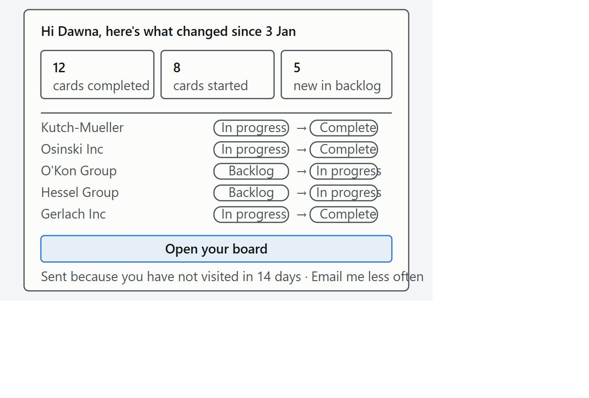
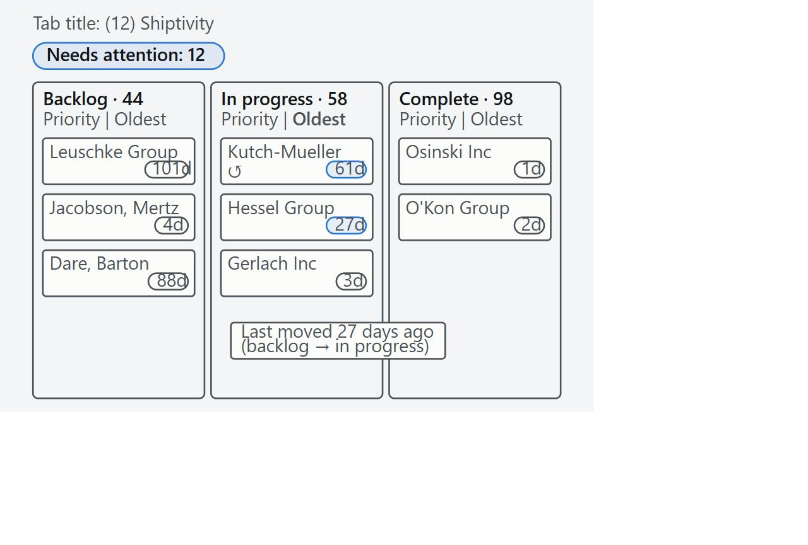
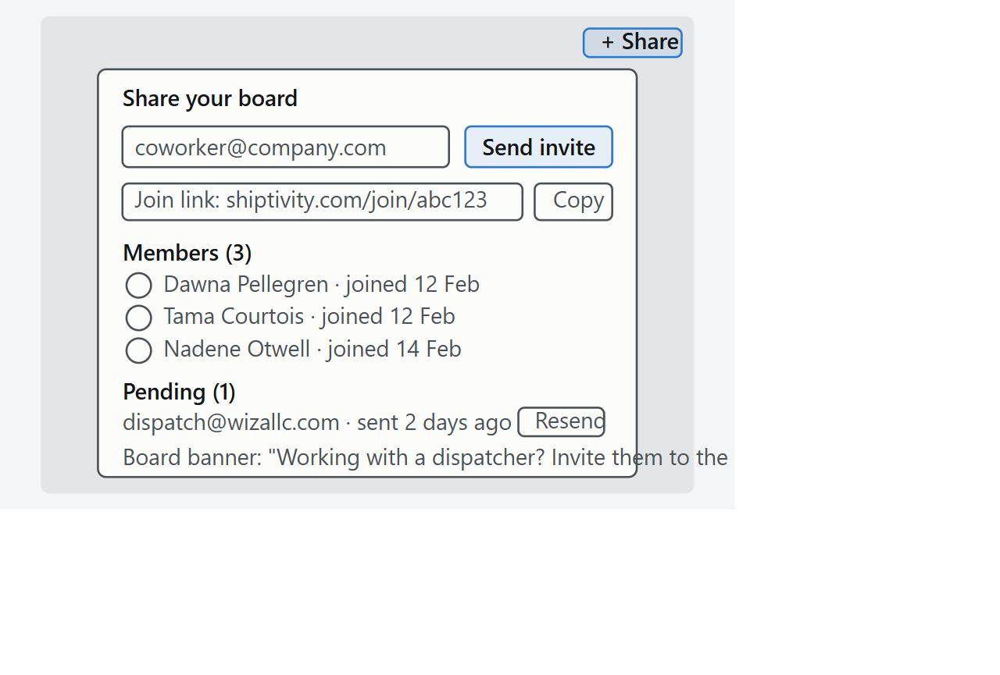

# Shiptivitas: three ideas to grow daily active users

Data-backed feature proposals after the Kanban board release. Forage, Working as a Software Engineer at a Start Up, task 3. David Slyusarchuk, 15 October 2026.

## What the data says

The Kanban board released on 2 June 2018 tripled daily active users (3.35 per day before, 11.79 after) and that level has held for eight months, but it has not grown since and each user is not coming back more often: stickiness (daily over monthly active users) fell from about 0.20 to 0.15, a typical user logs in every 5.6 days, and 35 of 99 users have been quiet for more than two weeks.

The board was used for looking before moving: status changes stayed at 0 to 3 a week until autumn, 38 of 200 cards have never left the backlog, and 46 of the 58 in-progress cards have not moved in 14 days.

The three ideas below attack daily active users from three sides: bringing quiet users back, giving active users a reason to open the board every day, and raising the ceiling on how many people use it. Each follows the ticket format (hypothesis, expected impact, what the feature is) and cites the queries in answer.sql behind every number. Twelve candidates were generated and scored before these three were chosen.

## Idea 1: "What changed since your last visit" email at 14 and 30 days away

*Idea 1 · bring users back*

**Hypothesis.** Users who have not logged in for two weeks have forgotten the board, not abandoned it. An email that summarises what moved on the board since their last login will bring more of them back within 7 days than sending nothing. We call it false if the emailed group's 7-day return rate is not at least 10 points above a holdout group that gets no email.

**Expected impact.** +0.5 to +1.0 average daily active users at steady state (4 to 8% on today's 11.8), plus a one-off recovery of 7 to 9 users, and an end to the slide from 12.9 average DAU in July to 10.2 in January. The arithmetic: 35 users have been quiet for more than 14 days today; if a quarter return and half of those resume the usual visit every 5.6 days, that is about +0.8 DAU. Since the release, roughly 40 login gaps a month have run past 14 days (333 in eight months), so the effect recurs.

**What the feature is.** A nightly job finds users whose last login was exactly 14 or 30 days ago and builds a board-wide summary from the change history since that login: cards completed, cards started, cards added, and the five most recent moves. It sends one email with those three counts, the five cards and an "Open your board" button, and logs every send with a random 50% holdout so the lift can be read straight from the login table. It needs an email column on the user table and nothing in the UI.

**Evidence.** 35 of the 99 users seen since the release have not logged in for more than 14 days and 20 for more than 30 (query 3b). Since the release the average gap between a user's logins is 5.6 days; 707 of 3,473 gaps exceed a week, 333 exceed two weeks and those average 31 days long (query 3a). Monthly active users held at 73 to 84 from July to January while average daily users drifted down, so the accounts exist but visit less and less.

**How we would measure it.** 7-day return rate by variant (email vs holdout) from the send log joined to login_history; the count of users 14+ and 30+ days inactive (targets: 35 to under 20, 20 to under 10 within two months); and the share of login gaps over 7 days, 20% today, aiming under 15%.

*Wireframe: the email:* `graphs/wireframe-1.svg` (also `.jpg`) in the repository.

## Idea 2: Card ageing badges with a "Needs attention" count and oldest-first sort

*Idea 2 · a reason to open the board every day*

**Hypothesis.** Cards go stale because nothing on the board separates a card touched yesterday from one untouched for two months. If every card shows days since its last move and the board shows how many cards need attention, the share of in-progress cards untouched for 14+ days will fall from 79% to under 40% within six weeks. We call it false if that share is still above 65%.

**Expected impact.** Leading metric: stale in-progress cards from 46 down to under 23. On daily active users, +1 to +2 (8 to 17% on 11.8): if each of the 46 stale cards gets one touch every two weeks instead of none, that is about 3 card touches a day, and a "Needs attention" number that changes daily gives the 64 users active in the final fortnight of data a concrete reason to open the board on days they would otherwise skip. It also raises the volume of status changes that any later notification depends on.

**What the feature is.** Every card gets a small age chip computed from its latest history row ("3d", "27d", "61d"). In the in-progress lane the chip turns amber at 14 days and red at 30; in the backlog, amber at 30. Cards that moved backwards show a small "bounced" icon. Each lane header gets a "Priority | Oldest" sort toggle, and the board header shows an amber pill "Needs attention: N" that sorts every lane oldest-first when clicked. The same count goes into the browser tab title. No new tables: the clients endpoint adds a last-moved timestamp per card from the history table.

**Evidence.** 58 cards are in progress; 46 of them (79%) have not moved in 14 days and 37 (64%) in 30 days, averaging 54 days since the last move. 44 backlog cards have waited 102 days on average. 53 cards were started and never finished, 38 never left the backlog, and there are 16 backward moves. There were about 12 logins for every status change (3,572 post-release logins against 286 changes), so most visits are likely looks, not edits.

**How we would measure it.** Weekly: the stale share of in-progress cards (query 2e, baseline 0.79, success under 0.40); the share of moves made on cards that had sat untouched for more than 14 days, 68% today (195 of 286, query 3e), which should fall below 40% as cards get touched sooner; and status changes per active user per week.

*Wireframe: the board:* `graphs/wireframe-2.svg` (also `.jpg`) in the repository.

## Idea 3: Invite a teammate: a shareable join link that adds colleagues to the board

*Idea 3 · raise the ceiling*

**Hypothesis.** The user base stopped growing because there is no way for a user to add a colleague, yet every shipper works with a dispatcher, a warehouse contact or a manager who would use the same board. A two-click invite will add at least 25 activated users (a login within 7 days of joining) within a quarter and push monthly active users above the current ceiling of 84. We call it false if fewer than 15% of active users send an invite, or invited users average fewer than 3 active days in their first month.

**Expected impact.** +4 to +6 average daily active users within a quarter (about 12 to 16-18), through +25 to +40 monthly active users. The arithmetic: 64 users were active in the final fortnight of data (18 Jan to 1 Feb, query 3b); if 30% send one invite and half the invitees join, that is about 10 new users in the first month and 25 to 40 over a quarter. At today's stickiness of 0.13 to 0.17 each new user adds roughly 0.15 DAU. The precedent is the release itself: 43 people logged in for the first time in June 2018, which is what moved average DAU from 5.5 to 11.9. With 100 accounts and 15% stickiness, DAU is capped near 15 however good the board gets.

**What the feature is.** All 100 users already share one board, so version one adds people to that board and skips any workspace model. A "Share" button in the board header opens a modal with an email field, a "Send invite" button and a copyable join link that works in the shipper's own email or chat before any email provider exists. Visiting the link asks for a name, creates the user with "invited by" set, and drops them on the board with the same edit rights everyone has today. Users who have never invited anyone see a one-line banner: "Working with a dispatcher or manager? Invite them to the board".

**Evidence.** First logins per user (query 3c): 43 in June 2018, 9 in July, 6 in August, none in September, then one a month from October to January. 96 of the 100 accounts were on board by the end of August and only 4 have joined since. Monthly active users have sat between 73 and 84 every month from July to January while average daily users plateaued, and the schema has no email, company or sign-up fields, so there is no self-serve way in. The task brief also notes that managers at customer companies want to be told when tasks are completed, which an invited manager could see for themselves.

**How we would measure it.** Monthly active users breaking above 84 and average DAU per calendar day (query 1c); weekly new users with "invited by" set; invite acceptance rate; share of recently active users who sent an invite; and invited users' active days in their first 30 days compared with existing users, which must not be below half.

*Wireframe: the Share modal:* `graphs/wireframe-3.svg` (also `.jpg`) in the repository.

## What we set aside

Twelve ideas were generated from four angles (retention, board throughput, collaboration, growth) and scored by three reviewers playing a data analyst, a founder and an engineering lead. Six of the nine rejected ideas were email or notification variants, including a working-day digest with stale-card nudges that every reviewer rated highly; the win-back email beat them because it needs no UI and ships with a built-in holdout, and the digest is the natural second email once that probe shows email moves logins. Due dates and a first-move walkthrough shared the ageing badges' mechanism but depend on users entering data or sitting through a tour. A public shipment status page and a comments feed had no evidence of demand in the data.

## Where the numbers come from

Every figure above was computed from `shiptivity.db` with the queries in `answer.sql` (Part 1 for daily active users, Part 2 for status changes by card, Part 3 for the supporting figures). The full report with graphs, table views and SQL is `analytics-report.html` in the same repository.
